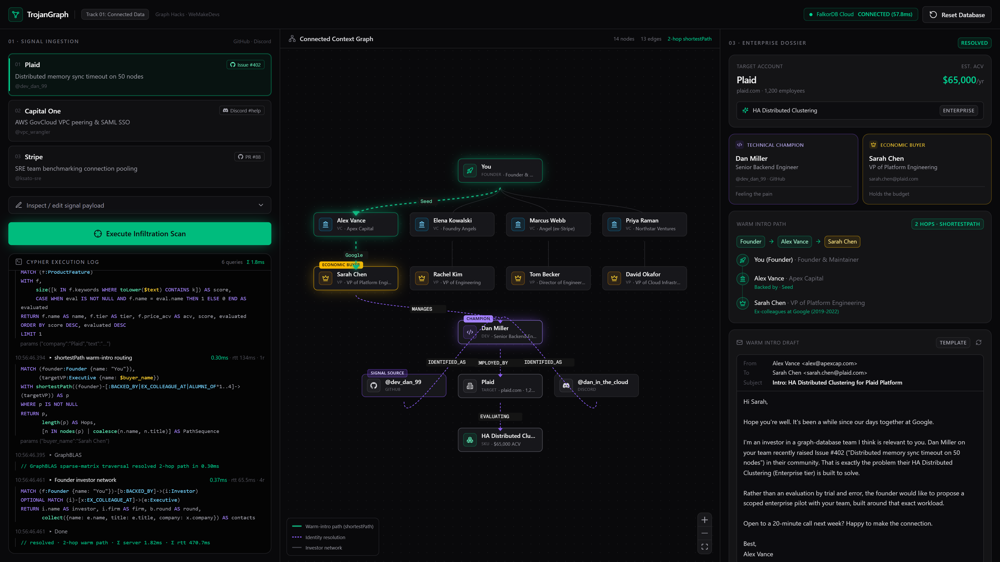
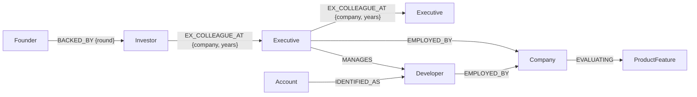

# TrojanGraph

**Revenue intelligence that walks the graph.** TrojanGraph turns a single developer complaint in a GitHub issue or Discord channel into a full enterprise deal brief: who the developer really is, who holds the budget above them, which paid feature solves their pain, and the shortest warm-intro path from the founder to that buyer through the founder's investor network. Every one of those answers is a FalkorDB traversal.

> **Hackathon track:** Agents That Act on Connected Data
>
> **Live demo:** _add your Vercel URL here_ · **Demo video:** _add your video URL here_



---

## What it does

1. **Ingest friction.** Pick a scenario card (or paste any GitHub/Discord text). Example: GitHub Issue #402 by `@dev_dan_99`, "Distributed memory sync timeout on 50 nodes".
2. **Resolve identity.** The pseudonymous handle is matched to an `Account` node, which is `IDENTIFIED_AS` a real `Developer`. Every sibling account (e.g. Discord `dan_in_the_cloud`) is merged into the same person.
3. **Find the economic buyer.** It walks `Developer -[:EMPLOYED_BY]-> Company` and `Executive -[:MANAGES]-> Developer` to find the VP who owns the budget.
4. **Map pain to revenue.** The signal text is scored against `ProductFeature` keywords, boosted if the company is already `EVALUATING` that feature.
5. **Route the warm intro.** `shortestPath()` from the founder to the buyer over `BACKED_BY | EX_COLLEAGUE_AT | ALUMNI_OF` edges finds the fewest-hop introduction (2 hops for Plaid, 3 hops for Stripe, with longer decoy routes rejected).
6. **Act.** A briefing email is drafted in the investor's voice, grounded only in the facts the graph returned. It can be copied or pushed to Slack/HubSpot.

Every Cypher query and its FalkorDB engine time streams live into an on-screen terminal, so you can watch the agent think.

## Why the graph is load-bearing

Take FalkorDB out and TrojanGraph does nothing. There is no other datastore: no SQL tables, no JSON fixtures at runtime, no cache.

| Question the product answers | How it's answered |
|---|---|
| Who is `@dev_dan_99` really? | `(:Account)-[:IDENTIFIED_AS]->(:Developer)` traversal |
| Who signs the cheque? | `(:Executive)-[:MANAGES]->(:Developer)-[:EMPLOYED_BY]->(:Company)` |
| What else do we know about this person? | Reverse traversal to every `Account` of the same `Developer` |
| Who can introduce us? | `shortestPath()` across the investor/ex-colleague network, variable length 1..4 |

The warm-intro routing is a variable-length path search over a social graph, which is exactly what flat SQL (recursive CTEs over many join tables) and vector databases (no notion of paths) are bad at. In FalkorDB the whole six-query scan takes **about 2 ms of engine time**, and `shortestPath` takes **about 0.3 ms** (measured live and shown in the UI).

---

## Graph data model



### Nodes

| Label | Key properties | Meaning |
|---|---|---|
| `Founder` | `name`, `title`, `company` | The user of TrojanGraph (the startup founder) |
| `Investor` | `name`, `firm`, `role`, `email` | People who backed the founder |
| `Executive` | `name`, `title`, `email`, `company` | VPs/Directors: budget holders and intermediaries |
| `Company` | `name`, `domain`, `tier`, `employee_count` | Target enterprises and network companies |
| `Developer` | `name`, `title`, `work_email` | Real identity behind community handles |
| `Account` | `platform` (GitHub/Discord), `handle` | Pseudonymous community identity |
| `ProductFeature` | `name`, `tier`, `price_acv`, `keywords[]` | Paid features that solve specific pains |

### Relationships

| Type | Direction | Properties |
|---|---|---|
| `BACKED_BY` | Founder → Investor | `round` |
| `EX_COLLEAGUE_AT` | Investor/Executive → Executive | `company`, `years` |
| `EMPLOYED_BY` | Developer/Executive → Company | |
| `MANAGES` | Executive → Developer | |
| `IDENTIFIED_AS` | Account → Developer | |
| `EVALUATING` | Company → ProductFeature | |
| `ALUMNI_OF` | Person → School/Company | accepted by the routing query; not used in the seed |

Indexes: `Account(handle)`, `Executive(name)`, `Founder(name)`, `Developer(name)`, `Company(name)`.

The seed graph (`lib/seed.ts`) has 29 nodes and 33 edges: 3 target enterprises (Plaid, Capital One, Stripe), 4 investors, 5 executives, 4 developers with 7 accounts, and 3 enterprise features. It deliberately includes **decoy routes** (e.g. a 3-hop path to Sarah Chen via Tom Becker) so `shortestPath` has real alternatives to reject.

---

## Cypher queries the product depends on

All read queries run through `GRAPH.RO_QUERY` (`lib/falkordb.ts`), and the engine time is taken from FalkorDB's query metadata. The full pipeline lives in `lib/scan.ts`.

**1. Resolve the pseudonymous handle from raw signal text**
```cypher
MATCH (acc:Account)
WHERE toLower($text) CONTAINS toLower(acc.handle)
RETURN acc.handle AS handle, acc.platform AS platform
ORDER BY size(acc.handle) DESC
LIMIT 1
```

**2. Identity and hierarchy traversal (champion → company → economic buyer)**
```cypher
MATCH (acc:Account {handle: $handle})-[:IDENTIFIED_AS]->(dev:Developer)
MATCH (dev)-[:EMPLOYED_BY]->(comp:Company)
MATCH (exec:Executive)-[:MANAGES]->(dev)
RETURN dev.name AS ChampionName, dev.work_email AS ChampionEmail, dev.title AS ChampionTitle,
       acc.platform AS Platform, comp.name AS TargetCompany, comp.domain AS Domain,
       comp.tier AS Tier, comp.employee_count AS Employees,
       exec.name AS BuyerName, exec.title AS BuyerTitle, exec.email AS BuyerEmail
```

**3. Cross-platform identity merge**
```cypher
MATCH (dev:Developer {name: $champion})<-[:IDENTIFIED_AS]-(acc:Account)
RETURN acc.platform AS platform, acc.handle AS handle
```

**4. Map friction to an enterprise feature**
```cypher
MATCH (comp:Company {name: $company})
OPTIONAL MATCH (comp)-[:EVALUATING]->(eval:ProductFeature)
WITH eval
MATCH (f:ProductFeature)
WITH f,
     size([k IN f.keywords WHERE toLower($text) CONTAINS k]) AS score,
     CASE WHEN eval IS NOT NULL AND f.name = eval.name THEN 1 ELSE 0 END AS evaluated
RETURN f.name AS name, f.tier AS tier, f.price_acv AS acv, score, evaluated
ORDER BY score DESC, evaluated DESC
LIMIT 1
```

**5. Warm-intro routing with `shortestPath`**
```cypher
MATCH (founder:Founder {name: "You"}),
      (targetVP:Executive {name: $buyer_name})
WITH shortestPath((founder)-[:BACKED_BY|EX_COLLEAGUE_AT|ALUMNI_OF*1..4]->(targetVP)) AS p
WHERE p IS NOT NULL
RETURN p, length(p) AS Hops,
       [n IN nodes(p) | coalesce(n.name, n.title)] AS PathSequence
```

**6. Founder's investor network (rendered as the alternatives `shortestPath` rejected)**
```cypher
MATCH (f:Founder {name: "You"})-[b:BACKED_BY]->(i:Investor)
OPTIONAL MATCH (i)-[x:EX_COLLEAGUE_AT]->(e:Executive)
RETURN i.name AS investor, i.firm AS firm, b.round AS round,
       collect({name: e.name, title: e.title, company: x.company}) AS contacts
```

**Seeding** (`lib/seed.ts`) uses idempotent `UNWIND $rows ... MERGE` statements, for example:
```cypher
UNWIND $rows AS r MATCH (d:Developer {name: r.developer})
MERGE (a:Account {platform: r.platform, handle: r.handle})
MERGE (a)-[:IDENTIFIED_AS]->(d)
```

---

## Architecture

```
Browser (Next.js 15 + React 19 + React Flow + Tailwind 4)
   │  POST /api/scan  ── NDJSON stream: one event per Cypher query, then the result
   ▼
Next.js route handlers (Node.js runtime)
   ├── /api/scan    lib/scan.ts   → 6 read-only Cypher traversals (GRAPH.RO_QUERY)
   ├── /api/draft   lib/draft.ts  → email from graph facts (OpenAI optional, template fallback)
   ├── /api/reset   lib/seed.ts   → wipe + reseed the graph
   ├── /api/health                → FalkorDB connectivity + node/edge counts
   └── /api/push                  → Slack incoming webhook (optional)
   ▼
FalkorDB Cloud (falkordb npm client, singleton connection, timeouts)
```

### Key technical decisions

- **Streaming NDJSON** from `/api/scan` so each traversal appears in the UI the moment FalkorDB answers it.
- **Directed `shortestPath`.** FalkorDB doesn't support undirected `shortestPath`, so the network edges are seeded pointing away from the founder (Founder → Investor → Executive). There's a fallback to the undirected form if a future engine supports it.
- **`shortestPath` only in `WITH`/`RETURN`**, as FalkorDB requires.
- **Grounded generation.** The LLM (if configured) receives only the JSON facts returned by the graph and is told to describe the connection strictly via `warm_path` edges. Without an API key, a deterministic template is used, so the demo never depends on an LLM.
- **Read-only queries** for the scan path, with a singleton client that survives hot reloads, plus connect/query timeouts that surface friendly errors.

---

## Run it locally

**Requirements:** Node.js 20+ and a FalkorDB instance (FalkorDB Cloud free tier works; so does `docker run -p 6379:6379 falkordb/falkordb`).

```bash
git clone <this-repo-url> trojangraph
cd trojangraph
npm install
cp .env.example .env.local      # then edit FALKORDB_URL
npm run seed                    # loads the synthetic graph into FalkorDB
npm run dev                     # http://localhost:3000
```

### Environment variables

| Variable | Required | Description |
|---|---|---|
| `FALKORDB_URL` | yes | `redis://falkordb:<password>@<host>:<port>` (FalkorDB Cloud free tier has no TLS; use `rediss://` on TLS tiers, `redis://localhost:6379` for Docker) |
| `FALKORDB_GRAPH` | no | Graph key, default `trojangraph` |
| `OPENAI_API_KEY` | no | Enables LLM-written drafts; otherwise a graph-grounded template is used |
| `OPENAI_MODEL` | no | Default `gpt-4o-mini` |
| `SLACK_WEBHOOK_URL` | no | Enables "Push to Slack / HubSpot" |

You can also reseed from the UI with the **Reset Database** button in the header (`POST /api/reset`).

## Deploy to Vercel

1. Import the GitHub repo in Vercel (framework preset: **Next.js**, no build settings to change).
2. Add `FALKORDB_URL` (and optionally `OPENAI_API_KEY`, `SLACK_WEBHOOK_URL`) under **Settings → Environment Variables**.
3. Deploy. Seed the graph once (`npm run seed` locally against the same URL, or click **Reset Database** in the deployed app).

All API routes run on the Node.js runtime because the FalkorDB client needs TCP sockets.

---

## Project structure

```
app/            Next.js App Router page + API routes (scan, draft, reset, health, push)
components/     Command center UI: signal panel, Cypher terminal, React Flow graph canvas, dossier
lib/falkordb.ts FalkorDB client singleton, read/write helpers with engine timings
lib/scan.ts     The agent pipeline: 6 Cypher traversals → graph DTO + deal brief
lib/seed.ts     Synthetic seed graph (idempotent MERGE) + indexes
lib/draft.ts    Graph-grounded email drafting (OpenAI or template)
scripts/seed.ts CLI seeder (npm run seed)
demo-video/     Remotion project used to produce the demo video from real app captures
```

## Data

All data in the graph is **synthetic**. The people, emails, handles, investors and relationships were invented for this demo. Company names (Plaid, Capital One, Stripe, Datadog, Robinhood) are used only as public, illustrative targets. No private, scraped, login-protected or personal data is loaded.

## AI disclosure

AI coding assistants (Cursor with Claude) were used during development: scaffolding UI components, writing boilerplate, debugging FalkorDB query syntax, and producing the Remotion demo video. The product concept, graph data model, query design and architecture decisions were directed, reviewed and verified by me against a live FalkorDB Cloud instance. At runtime, the optional LLM is only used to phrase an email from facts the graph has already returned.

## License

MIT
