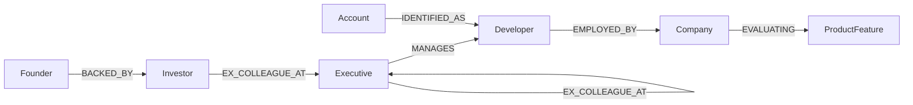

# TrojanGraph

**Turn one developer complaint into a warm enterprise intro, by walking a graph.**

**Track:** Agents That Act on Connected Data · **Live:** _your-vercel-url_ · **Video:** _your-video-url_


## The idea

Open-source and dev-tool startups have their best enterprise leads hiding in plain sight. A Plaid engineer posts *"distributed memory sync timeout on 50 nodes"* on GitHub as `@dev_dan_99`. That's a buying signal, but nobody knows:

- **Who** is `@dev_dan_99`, really?
- **Who holds the budget** above them?
- **Who can introduce** the founder to that person?

Those are relationship questions, and relationships are a graph. TrojanGraph is an agent that answers all three with FalkorDB traversals, then **acts**: it drafts the intro email the founder's investor can forward.

## How it works

```
GitHub / Discord post
   │
   ├─1─ Resolve handle        @dev_dan_99 ──IDENTIFIED_AS──▶ Dan Miller
   ├─2─ Walk the org chart    Sarah Chen ──MANAGES──▶ Dan ──EMPLOYED_BY──▶ Plaid
   ├─3─ Merge identities      Dan ◀── @dan_in_the_cloud (Discord)
   ├─4─ Match pain → product  "50 nodes, failover" → HA Distributed Clustering ($65K)
   ├─5─ Route a warm intro    shortestPath: You → Alex Vance (investor) → Sarah Chen
   └─6─ Act                   Draft grounded email · copy · push to Slack
```

Each step is a Cypher query. Results stream to the UI live (NDJSON), along with FalkorDB's engine time for each query. A full scan takes **about 2 ms** of graph time.

## Graph model



| Node | Purpose |
|---|---|
| `Account` (platform, handle) | Pseudonymous GitHub/Discord identity |
| `Developer` | The real person behind one or more accounts: the **champion** |
| `Executive` | VP/Director: the **economic buyer**, or an intermediary on an intro path |
| `Company` | Target enterprise |
| `ProductFeature` (tier, price_acv, keywords) | Paid feature that solves a specific pain |
| `Founder`, `Investor` | The founder's network, where warm intros start |

The seed (`lib/seed.ts`) is 29 nodes and 33 edges of **synthetic** data across three scenarios (Plaid, Capital One, Stripe). It includes deliberate decoy routes so the path search has real alternatives to reject.

## Graph techniques used

| Technique | Where | What it does |
|---|---|---|
| **Pattern matching** | Handle resolution | Finds the `Account` whose handle appears in the raw post text |
| **Multi-hop traversal** | Identity + hierarchy | `Account → Developer → Company` and `Executive → Developer` in one query |
| **Reverse traversal** | Identity merge | From the developer back to *all* their accounts (GitHub + Discord) |
| **Scoring with list comprehension** | Feature match | Counts keyword hits per feature; boosts features the company is already `EVALUATING` |
| **`shortestPath()` (variable length 1..4)** | Warm intro | Fewest-hop route from founder to buyer over `BACKED_BY \| EX_COLLEAGUE_AT \| ALUMNI_OF` |

**About `shortestPath`:** it's an unweighted breadth-first search. FalkorDB stores relationships as sparse adjacency matrices and runs traversals as GraphBLAS matrix operations, which is why routing through the investor network takes about **0.3 ms**. For Plaid it finds a 2-hop path. For Stripe it finds a 3-hop path (You → Marcus Webb → Tom Becker → Maya Lindqvist) and ignores longer ones.

**Why a graph:** in SQL this is recursive CTEs over half a dozen join tables per lead, and a vector database can't follow `MANAGES → BACKED_BY` chains at all. Without FalkorDB, TrojanGraph has no data and no answers. There is no other datastore.

## Cypher queries

All scan queries are read-only (`GRAPH.RO_QUERY`). They're shown slightly abridged here; the full versions are in [`lib/scan.ts`](lib/scan.ts).

```cypher
// 1. Resolve the handle mentioned in the post
MATCH (acc:Account) WHERE toLower($text) CONTAINS toLower(acc.handle)
RETURN acc.handle, acc.platform ORDER BY size(acc.handle) DESC LIMIT 1

// 2. Champion → company → economic buyer
MATCH (acc:Account {handle: $handle})-[:IDENTIFIED_AS]->(dev:Developer)
MATCH (dev)-[:EMPLOYED_BY]->(comp:Company)
MATCH (exec:Executive)-[:MANAGES]->(dev)
RETURN dev.name, dev.title, comp.name, exec.name, exec.title, exec.email

// 3. Every account belonging to the same person
MATCH (dev:Developer {name: $champion})<-[:IDENTIFIED_AS]-(acc:Account)
RETURN acc.platform, acc.handle

// 4. Map the pain to a paid feature
MATCH (comp:Company {name: $company})
OPTIONAL MATCH (comp)-[:EVALUATING]->(eval:ProductFeature)
WITH eval MATCH (f:ProductFeature)
WITH f, size([k IN f.keywords WHERE toLower($text) CONTAINS k]) AS score,
     CASE WHEN f.name = eval.name THEN 1 ELSE 0 END AS evaluated
RETURN f.name, f.tier, f.price_acv ORDER BY score DESC, evaluated DESC LIMIT 1

// 5. Warm-intro route
MATCH (founder:Founder {name: "You"}), (vp:Executive {name: $buyer_name})
WITH shortestPath((founder)-[:BACKED_BY|EX_COLLEAGUE_AT|ALUMNI_OF*1..4]->(vp)) AS p
WHERE p IS NOT NULL
RETURN p, length(p) AS hops, [n IN nodes(p) | n.name] AS route

// 6. The founder's wider network (drawn as the routes that weren't chosen)
MATCH (f:Founder {name: "You"})-[b:BACKED_BY]->(i:Investor)
OPTIONAL MATCH (i)-[x:EX_COLLEAGUE_AT]->(e:Executive)
RETURN i.name, i.firm, b.round, collect({name: e.name, company: x.company})
```

Seeding uses idempotent `UNWIND $rows … MERGE` statements plus indexes on the lookup keys ([`lib/seed.ts`](lib/seed.ts)).

## Design decisions

- **Directed `shortestPath`.** FalkorDB doesn't support undirected `shortestPath`, so network edges are stored pointing away from the founder.
- **Grounded email.** The LLM only sees the facts the graph returned and must describe the connection using the path edges alone. With no API key, a deterministic template is used, so the demo never depends on an LLM.
- **Streaming.** `/api/scan` streams one event per query, so you watch the agent reason in real time.

## Stack

Next.js 15 · React 19 · React Flow · Tailwind 4 · `falkordb` Node client · FalkorDB Cloud · optional OpenAI

```
app/api/scan     agent pipeline (6 traversals, streamed)
app/api/draft    email from graph facts
app/api/reset    wipe + reseed the graph
app/api/health   connectivity + node/edge counts
lib/             falkordb client, scan, seed, draft
components/      signal panel, Cypher terminal, graph canvas, dossier
```

## Run locally

Requires Node 20+ and a FalkorDB instance (FalkorDB Cloud free tier, or `docker run -p 6379:6379 falkordb/falkordb`).

```bash
npm install
cp .env.example .env.local   # set FALKORDB_URL
npm run seed                 # load the synthetic graph
npm run dev                  # http://localhost:3000
```

| Variable | |
|---|---|
| `FALKORDB_URL` | **Required.** `redis://falkordb:<password>@<host>:<port>` (`rediss://` on TLS tiers) |
| `FALKORDB_GRAPH` | Optional graph key, default `trojangraph` |
| `OPENAI_API_KEY`, `OPENAI_MODEL` | Optional LLM drafts (default `gpt-4o-mini`) |
| `SLACK_WEBHOOK_URL` | Optional "Push to Slack" |

**Deploy on Vercel:** import the repo (Next.js preset), add `FALKORDB_URL` as an environment variable, and deploy. If the graph is empty, click **Reset Database** in the app to seed it.

## Data & AI disclosure

- **Data:** fully synthetic. People, handles, emails and relationships are invented; company names are only illustrative targets. No private or scraped data.
- **AI assistance:** built with Cursor (Claude) for scaffolding, boilerplate, debugging and producing the demo video. The concept, graph model, queries and architecture were designed, reviewed and verified by the author against a live FalkorDB Cloud instance.

## License

MIT
